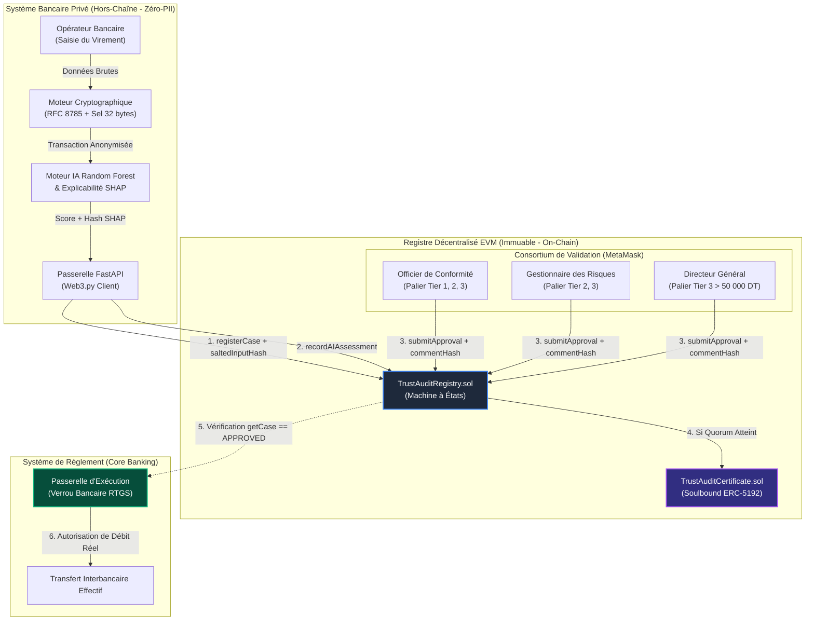
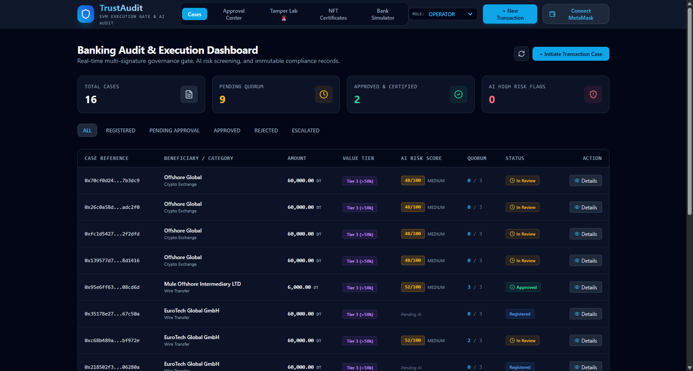
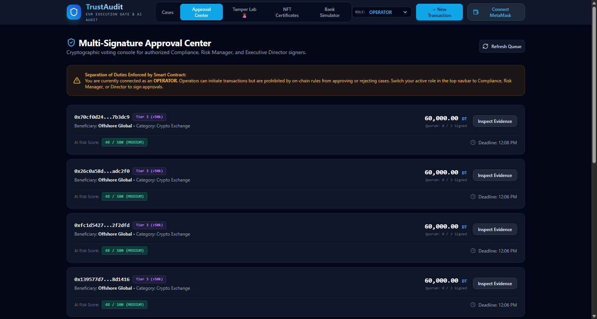
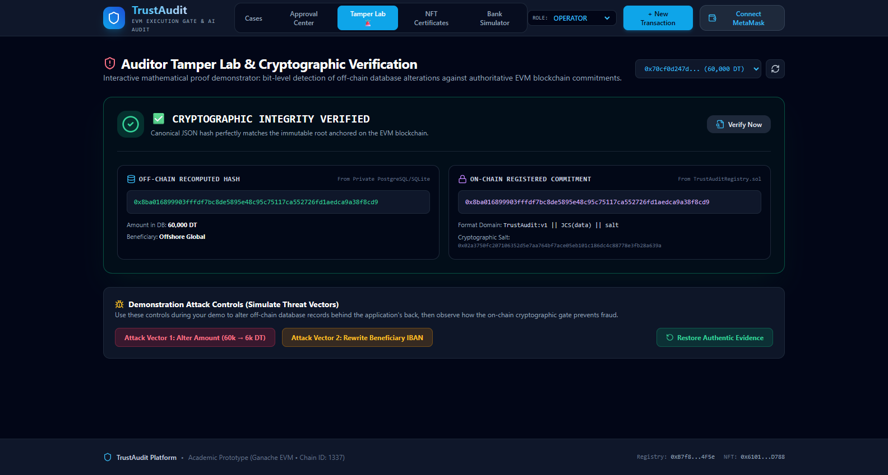
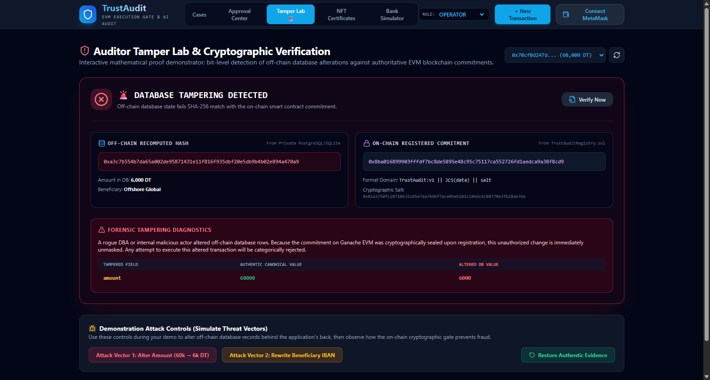
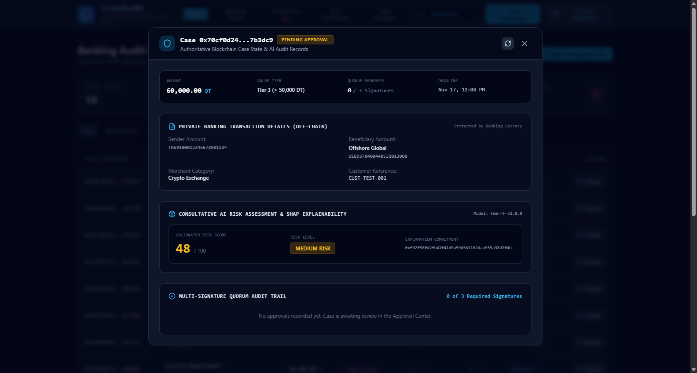
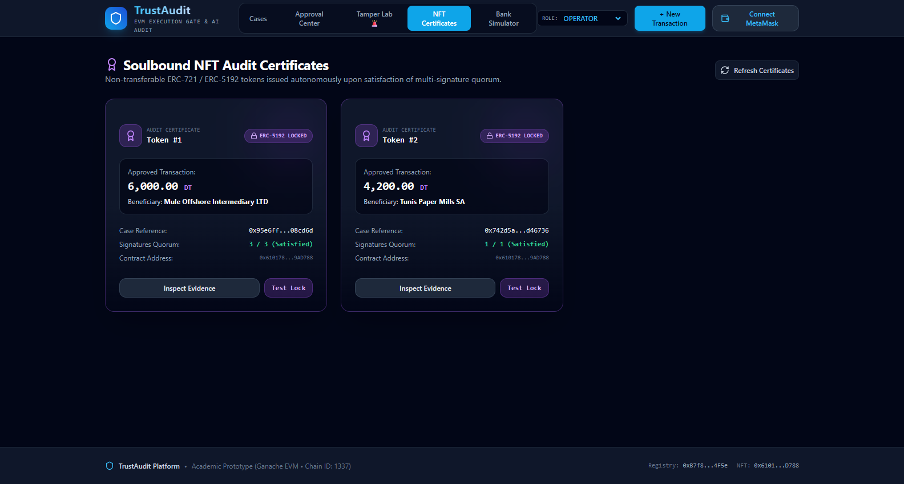

<p align="center">
  
</p>

<h1 align="center">TrustAudit</h1>
<h3 align="center">Registre Décentralisé d'Audit &amp; Verrou d'Exécution Blockchain pour Transactions Bancaires Sensibles</h3>

<p align="center">
  <b>Plateforme d'Audit Financier Assistée par IA Explicable (SHAP), Quorums Multi-Signatures (MetaMask) &amp; Attestations Soulbound NFT (ERC-5192)</b>
  <br />
  <i>Conception Zero-PII conforme au RGPD (Art. 17) &amp; Supervision Humaine Garantie selon l'EU AI Act (Art. 14)</i>
</p>

<p align="center">
  <a href="https://soliditylang.org/"></a>
  <a href="https://openzeppelin.com/"></a>
  <a href="https://fastapi.tiangolo.com/"></a>
  <a href="https://react.dev/"></a>
  <a href="https://scikit-learn.org/"></a>
  <a href="https://eips.ethereum.org/EIPS/eip-5192"></a>
</p>

---

## 🎥 Démonstration Vidéo Officielle du Projet

https://github.com/user-attachments/assets/01cd9b19-0a06-453b-972b-5f89d5e1deca

<p align="center">
  <a href="https://github.com/MedSalimGh/Trust-Audit/releases/download/1.0.0/TrustAusit.Video.mp4">
    
  </a>
  &nbsp;&nbsp;
  <a href="https://github.com/MedSalimGh/Trust-Audit/releases/tag/1.0.0">
    
  </a>
</p>

---

## 🎓 Dossier Académique & Encadrement Universitaire

> [!IMPORTANT]
> **Projet de Fin d'Études / Spécialisation Informatique — Promotion 2026**  
> **Établissement :** Faculté des Sciences de Sfax (FSS) — Université de Sfax, Tunisie  
> **Département :** Informatique & Génie Informatique (Spécialité : *Data Engineering & Blockchain*)  
> **Encadrant Universitaire :** **Pr. Claude Duvallet**  
> **Auteurs :** Med Salim Gharsellaoui · Nour Abed · Malek Dhahri  

---

## 📑 Documents Universitaires Officiels

<table align="center" width="100%">
  <tr>
    <td width="50%" align="center">
      <a href="./TrustAudit%20Rapport%20finale.pdf">
        
      </a>
      <br /><br />
      <b>📄 Rapport Académique Complet (Format IEEE / Mémoire d'Ingénieur)</b>
      <p><i>60+ pages détaillant la genèse mathématique, les diagrammes formels UML, l'audit de sécurité des contrats Solidity, la conformité RGPD/AI Act et les résultats expérimentaux.</i></p>
    </td>
    <td width="50%" align="center">
      <a href="./cahier%20de%20charge%20de%20TrustAudit.pdf">
        
      </a>
      <br /><br />
      <b>📋 Cahier des Charges & Spécifications Métier</b>
      <p><i>Spécification fonctionnelle et non-fonctionnelle complète, matrice des exigences LCB-FT, cas d'utilisation, modèle de données et charte d'ingénierie.</i></p>
    </td>
  </tr>
</table>

---

## 📌 Présentation Générale & Problématique

Dans l'écosystème bancaire contemporain, l'auditabilité et la conformité des flux financiers représentent un enjeu stratégique majeur. Lorsqu'une transaction sensible est suspectée de blanchiment d'argent ou de fraude (LCB-FT / AML), elle subit une vérification humaine rigoureuse. Or, l'état de l'art actuel souffre de **deux vulnérabilités structurelles critiques** :

```
┌───────────────────────────────────────────────┐       ┌───────────────────────────────────────────────┐
│     Vulnérabilité 1 : Centralisation SQL      │       │     Vulnérabilité 2 : Supervision IA Factice  │
│  Les logs de validation résident dans des DB  │       │  L'EU AI Act (Art. 14) interdit l'automatisa- │
│  centralisées modifiables par des DBA / admins│       │  tion unilatérale à haut risque. L'IA doit    │
│  → Risque de falsification rétroactive interne│       │  rester consultative avec traçabilité humaine.│
└───────────────────────────────────────────────┘       └───────────────────────────────────────────────┘
```

### 💡 La Solution TrustAudit : Le Verrou Décentralisé (*Execution Gate*)

**TrustAudit** introduit un paradigme novateur fondé sur la blockchain Ethereum / EVM :
1. **La blockchain ne transfère pas les fonds réels** : Elle agit comme une **autorité d'homologation souveraine**. Le système de virement interbancaire (RTGS / Core Banking) est physiquement verrouillé tant que le Smart Contract n'a pas atteint l'état `APPROVED`.
2. **Confidentialité Totale (*Zero-PII on Blockchain*)** : Aucune donnée bancaire en clair n'est transmise sur la chaîne. Seules des empreintes cryptographiques salées sont ancrées, respectant le RGPD (Droit à l'oubli).
3. **IA Consultative & Explicable (SHAP)** : L'IA pré-qualifie le risque et calcule les facteurs d'explication locaux (SHAP). Son analyse est scellée on-chain mais n'a aucun pouvoir de décision unilatéral.
4. **Quorums Multi-Signatures Hiérarchiques** : De 1 à 3 signatures humaines distinctes sont exigées via **MetaMask** selon le montant de la transaction et la recommandation de l'IA.
5. **Attestation Soulbound Non-Transférable (ERC-5192)** : Une fois le consensus atteint, le contrat émet un NFT infalsifiable et verrouillé à jamais dans le coffre d'audit de la banque.

---

## 🏛️ Matrice Comparative : Système Classique vs TrustAudit

| Dimension Analysée | Système Bancaire Traditionnel | Solution TrustAudit (Blockchain + IA) |
| :--- | :--- | :--- |
| **Intégrité de l'Audit Trail** | ❌ Bases SQL modifiables par des administrateurs à posteriori. | ✅ **Immuabilité mathématique absolue** sur blockchain EVM. |
| **Supervision de l'IA** | ❌ Boîtes noires opaques sans traçabilité des explications. | ✅ **Empreinte SHAP scellée on-chain** (`explanationHash`). |
| **Gouvernance des Décisions** | ❌ Approbations unilatérales simples, souvent sans trace signée. | ✅ **Quorum multi-sig cryptographique** (MetaMask, règle des 4 yeux). |
| **Confidentialité & RGPD** | ⚠️ Risque de fuite si la blockchain contient des identités. | ✅ **Zéro-PII On-Chain** : JSON RFC 8785 salé à 32 octets aléatoires. |
| **Contrôle d'Exécution** | ⚠️ Déclenchement automatique sans garde-fou certifié. | ✅ **Verrou d'Exécution (*Execution Gate*)** conditionné par le statut on-chain. |
| **Attestation Réglementaire** | ❌ Rapports PDF / papier faciles à contrefaire. | ✅ **Soulbound Token (ERC-5192)** infalsifiable et non transférable. |

---

## ⚙️ Architecture & Circuit de Décision



### 🔢 Quorums Dynamiques par Paliers de Risque

$$\begin{cases}
\text{Tier 1 } (< 5\,000\text{ DT/€}) & \implies \mathbf{1\text{ Signature}} \text{ (Officier de Conformité)} \\
\text{Tier 1 + Overlay IA (High Risk)} & \implies \mathbf{2\text{ Signatures}} \text{ (Élévation automatique on-chain : Conformité + Risque)} \\
\text{Tier 2 } (5\,000 \text{ à } 50\,000\text{ DT/€}) & \implies \mathbf{2\text{ Signatures}} \text{ (Conformité + Gestionnaire des Risques)} \\
\text{Tier 3 } (> 50\,000\text{ DT/€}) & \implies \mathbf{3\text{ Signatures}} \text{ (Conformité + Gestionnaire des Risques + Direction)}
\end{cases}$$

---

## 🔐 Protocole Cryptographique & Respect du RGPD

Le RGPD (**Article 17 : Droit à l'effacement**) et la blockchain (**Immuabilité**) sont en apparence contradictoires. TrustAudit résout ce dilemme par un protocole cryptographique rigoureux :

$$\mathbf{SaltedInputHash} = \operatorname{SHA-256}\Big(\text{"TrustAudit:v1"} \;\parallel\; \operatorname{JCS}(\text{TransactionData}) \;\parallel\; \mathbf{SecretSalt}_{32\text{ bytes}}\Big)$$

```
┌─────────────────────────────────┐
│     JSON Bancaire en Clair      │
│  { "amount": 15000, ... }       │
└────────────────┬────────────────┘
                 │
                 ▼ 1. Canonicalisation RFC 8785 (JCS)
┌─────────────────────────────────┐
│     JSON Canonique Uniforme     │
│  {"amount":15000,"currency"...} │
└────────────────┬────────────────┘
                 │
                 ▼ 2. Sel Aléatoire Cryptographique (32 octets CSPRNG) + Préfixe de Domaine
┌─────────────────────────────────┐
│ "TrustAudit:v1" || JCS || Salt  │
└────────────────┬────────────────┘
                 │
                 ▼ 3. Hachage SHA-256
┌─────────────────────────────────────────────────────────────────┐
│ Empreinte bytes32 Ancrée On-Chain (0x7f4c91b...a82)             │
│ Aucune PII révélée • Résistant aux attaques par dictionnaire    │
└─────────────────────────────────────────────────────────────────┘
```

> [!TIP]
> **Droit à l'Oubli Garanti :** Si un client exige l'effacement de ses données personnelles, la banque supprime sa ligne dans la base SQL privée ainsi que le sel aléatoire. L'empreinte stockée sur la blockchain devient mathématiquement orpheline et irréversible, respectant simultanément l'auditabilité et le RGPD.

---

## 🔍 Laboratoire Anti-Falsification (*Tamper-Proof Lab*)

La DApp TrustAudit intègre un écran dédié d'audit mathématique en temps réel, permettant à un contrôleur ou un inspecteur externe (BCT, ACPR, BCE) de vérifier l'intégrité absolue d'un dossier bancaire.

```
                    ┌────────────────────────────┐
                    │ Base de Données Privée SQL │
                    └─────────────┬──────────────┘
                                  │
                                  ▼
                    Reconstruction RFC 8785 + Sel
                                  │
                                  ▼
                      Nouveau Hash Local Calculé
                                  │
                                  ├──► Confrontation Mathématique ◄──┐
                                  │                                  │
                                  ▼                                  ▼
                    ┌────────────────────────────┐     ┌────────────────────────────┐
                    │  Hash Calculé Hors-Chaîne  │ === │   Hash Scellé On-Chain     │
                    └────────────────────────────┘     └────────────────────────────┘
                                  │
                     ┌────────────┴────────────┐
                     ▼                         ▼
            [HASHES IDENTIQUES]       [HASH DIVERGENT !]
            ✅ Dossier Authentique     🚨 ALERTE FALSIFICATION
            Audit Trail Intègre       Altération de Données Détectée
```

---

## 📸 Galerie & Captures de l'Application

<div align="center">

### 1. Dashboard Exécutif & Surveillance des Quorums


<br /><br />

### 2. Console d'Approbation Multi-Signatures (MetaMask)


<br /><br />

### 3. Laboratoire Anti-Falsification (Détection d'Altération en Temps Réel)

&nbsp;


<br /><br />

### 4. Explicabilité de l'IA (SHAP Waterfall) & Galerie des Certificats Soulbound (ERC-5192)

&nbsp;


</div>

---

## 🛡️ Les Smart Contracts & Sécurité On-Chain

Les contrats intelligents de **TrustAudit** ont été développés en Solidity `^0.8.24` et testés rigoureusement selon les standards OpenZeppelin v5.

<details>
<summary><b>▶ Déplier pour examiner le code source résumé et les règles de sécurité</b></summary>

### 1. `TrustAuditRegistry.sol`
* **Rôle :** Autorité d'exécution et de consensus multi-sig.
* **Invariants Majeurs :**
  - `require(c.status == CaseStatus.PENDING_APPROVAL, "Invalid state");`
  - `require(!_hasApproved[caseId][msg.sender], "Already approved by this address");`
  - `require(msg.sender != c.operator, "Operator cannot approve own case (Four-Eyes Principle)");`
  - `require(commentHash != bytes32(0), "Justification hash required");`

### 2. `TrustAuditCertificate.sol` (Soulbound Token ERC-5192)
* **Rôle :** Émission d'attestations non-transférables scellant le consensus.
* **Invariants Majeurs :**
  - Inaliénabilité totale : `locked(tokenId)` retourne perpétuellement `true`.
  - Rejet systématique de `transferFrom` et `safeTransferFrom` avec l'erreur `ErrSoulboundTokenNonTransferable()`.
  - Destinataire unique et souverain : l'adresse du coffre bancaire institutionnel.

</details>

---

## 🚀 Guide de Démarrage Rapide (1-Clic)

Pour reproduire et tester la plateforme TrustAudit localement dans les conditions exactes de la soutenance :

### 1. Prérequis Système
- **Node.js** (v18 ou supérieur) avec `npm`
- **Python** (3.11 ou supérieur) avec `pip`
- Extension **MetaMask** installée dans le navigateur

### 2. Lancement Intégral en Une Seule Commande (PowerShell)

Ouvrez un terminal PowerShell à la racine du projet et exécutez :

```powershell
.\scripts\start-all.ps1
```

Ce script automatise l'ensemble de la chaîne de valeur :
1. Démarre le nœud de blockchain local Ganache (`http://127.0.0.1:8545`, Chain ID `1337`).
2. Compile et déploie les Smart Contracts (`TrustAuditRegistry` et `TrustAuditCertificate`).
3. Attribue les rôles cryptographiques RBAC aux comptes de test.
4. Lance le serveur backend **FastAPI** (`http://localhost:8000`).
5. Lance le worker d'écoute d'événements blockchain en arrière-plan.
6. Démarre la DApp **React Vite** (`http://localhost:5173`).

<details>
<summary><b>▶ Comptes de Démonstration & Clés Privées MetaMask (Ganache Local)</b></summary>

| Rôle Métier | Adresse Publique Ethereum | Clé Privée pour Import MetaMask |
| :--- | :--- | :--- |
| **Administrateur & Déployeur** | `0xf39Fd6e51aad88F6F4ce6aB8827279cffFb92266` | `0xac0974bec39a17e36ba4a6b4d238ff944bacb478cbed5efcae784d7bf4f2ff80` |
| **Opérateur Bancaire (Saisie)** | `0x70997970C51812dc3A010C7d01b50e0d17dc79C8` | `0x59c6995e998f97a5a0044966f0945389dc9e86dae88c7a8412f4603b6b78690d` |
| **Officier de Conformité** | `0x3C44CdDdB6a900fa2b585dd299e03d12FA4293BC` | `0x5de4111afa1a4b94908f83103eb2f954b14eecda8968814044470404e0e457df` |
| **Gestionnaire des Risques** | `0x90F79bf6EB2c4f870365E785982E1f101E93b906` | `0x7c852118294e51e653712a81e05800f419141751be58f605c371e15141b007a6` |
| **Directeur Général** | `0x15d34AAf54267DB7D7c367839AAf71A00a2C6A65` | `0x47e179ec346fe86e3244409f39253232ce5294f6470bcac06155b31acff1a953` |
| **Auditeur Externe (BCT / ACPR)** | `0x9965507D1a55bcC2695C58ba16FB37d819B0A4df` | `0x8b3a350cf5c34c9194ca85829a2df0ec3153be0318b5e2d3365e430c949dd4ee` |

</details>

---

## 🧪 Validation & Tests Automatisés

L'architecture est couverte par des suites de tests exhaustives garantissant la robustesse à tous les niveaux :

```bash
# 1. Tests des Smart Contracts (Hardhat - 19 tests nominaux et scénarios d'attaque)
cd contracts
npx hardhat test

# 2. Tests Unitaires & Intégration Backend (Pytest)
cd ../backend
pytest tests/

# 3. Validation TypeScript & Intégrité Frontend
cd ../frontend
npx tsc --noEmit
```

---

<div align="center">

### 🏛️ Université de Sfax — Faculté des Sciences de Sfax (FSS)
*Projet d'Ingénierie Blockchain & Data Engineering — Promotion 2026*  
**Supervisé par le Pr. Claude Duvallet**

<br />

[](https://github.com/MedSalimGh/Trust-Audit)

</div>
