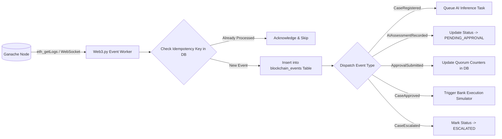

# TrustAudit — Blockchain Event Architecture & Indexer Specification

## 1. Smart Contract Event Definitions

Events represent the authoritative communication channel between the EVM consensus layer and the off-chain application layer.

```solidity
// SPDX-License-Identifier: MIT
pragma solidity ^0.8.24;

interface ITrustAuditEvents {
    enum RiskLevel { LOW, MEDIUM, HIGH }
    enum ApprovalRole { COMPLIANCE, RISK_MANAGER, DIRECTOR }

    /// @notice Emitted when an Operator registers a new transaction case
    event CaseRegistered(
        bytes32 indexed caseId,
        address indexed operator,
        bytes32 saltedInputHash
    );

    /// @notice Emitted when the AI Oracle records the advisory risk score
    event AIAssessmentRecorded(
        bytes32 indexed caseId,
        uint8 riskScore,
        RiskLevel riskLevel,
        bytes32 explanationHash
    );

    /// @notice Emitted when an authorized human approver signs
    event ApprovalSubmitted(
        bytes32 indexed caseId,
        address indexed approver,
        ApprovalRole role,
        bytes32 commentHash
    );

    /// @notice Emitted when an authorized human formally rejects a case
    event CaseRejected(
        bytes32 indexed caseId,
        address indexed rejector,
        bytes32 commentHash
    );

    /// @notice Emitted when quorum is met and the case reaches final approval
    event CaseApproved(
        bytes32 indexed caseId,
        uint256 certificateId
    );

    /// @notice Emitted when a case exceeds its deadline and is escalated
    event CaseEscalated(
        bytes32 indexed caseId,
        uint64 timestamp
    );
}

interface IERC5192Events {
    /// @notice Emitted when a Soulbound Token is permanently locked
    event Locked(uint256 tokenId);

    /// @notice Emitted when an audit NFT certificate is minted
    event AuditCertificateMinted(
        bytes32 indexed caseId,
        uint256 indexed tokenId,
        address indexed recipient
    );
}
```

---

## 2. Web3.py Asynchronous Event Indexer

### 2.1 Indexer Architecture & Data Flow
The Indexer is an autonomous background service (`backend/app/workers/event_worker.py`) built with Web3.py:



---

## 3. Idempotency & Fault Tolerance

### 3.1 Idempotency Key Definition
To prevent duplicate processing caused by indexer restarts or network retries, every event is keyed by:
$$\text{EventKey} = \text{SHA256}(\text{chainId} \parallel \text{"::"} \parallel \text{transactionHash} \parallel \text{"::"} \parallel \text{logIndex})$$
The `blockchain_events` database table enforces a `UNIQUE(chain_id, transaction_hash, log_index)` constraint.

### 3.2 Block Pointer & Cursor Management
- The indexer tracks `last_indexed_block` in a dedicated database metadata table.
- On startup, it queries Ganache for `eth_blockNumber`.
- If `last_indexed_block > current_block` (indicating Ganache was restarted/reset):
  - Indexer logs a `CHAIN_REORG_OR_RESET_DETECTED` warning.
  - Resets the cursor to block 0 or runs the re-synchronization procedure.

---

## 4. Event Processing Action Table

| Event | Database Update | Triggered Action |
| :--- | :--- | :--- |
| `CaseRegistered` | Update `audit_cases.status = 'REGISTERED'`; record `operator_address` | Notify AI Oracle service to run local inference. |
| `AIAssessmentRecorded` | Update `audit_cases.status = 'PENDING_APPROVAL'`; store `score`, `risk_level` | Enable approval actions in Frontend DApp for authorized roles. |
| `ApprovalSubmitted` | Insert into `approvals` table; increment `approval_count` | Re-render approval progress bar in DApp. |
| `CaseApproved` | Update `audit_cases.status = 'APPROVED'`; set `certificate_id` | **Trigger Bank Execution Simulator** with idempotent key. |
| `CaseRejected` | Update `audit_cases.status = 'REJECTED'` | Lock case actions; send terminal notification. |
| `CaseEscalated` | Update `audit_cases.status = 'ESCALATED'` | Notify Risk Director and Governance officers. |
| `AuditCertificateMinted`| Insert record into `nft_certificates` table | Link NFT token ID to case; display badge in DApp. |
