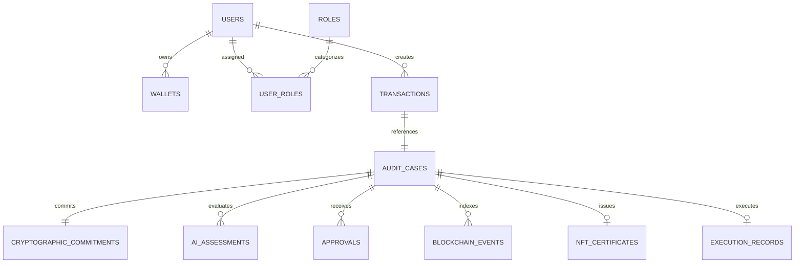

# TrustAudit — Database Schema & Data Dictionary

## 1. Schema Design Philosophy

The database architecture maintains strict **privacy partitioning**:
1. **Private Financial Domain**: Tables containing PII, raw transaction fields, IBANs, and secret salts (`transactions`, `cryptographic_commitments`).
2. **AI & Audit Domain**: Tables storing model inference snapshots, feature vectors, and complete SHAP explanations (`ai_assessments`, `approvals`).
3. **Blockchain Projection Domain**: Tables mirroring on-chain state, transaction receipts, and indexed contract events (`audit_cases`, `blockchain_events`, `nft_certificates`).
4. **Execution Domain**: Bank transfer execution records with idempotency constraints (`execution_records`).

---

## 2. Entity Relationship Diagram (ERD)

---

## 3. Data Dictionary & Table Definitions

### 3.1 `transactions` (Private Core Data)
*Stores sensitive banking transaction inputs off-chain.*

| Column | Type | Constraints | Description |
| :--- | :--- | :--- | :--- |
| `id` | UUID | PRIMARY KEY | Internal system UUID |
| `customer_reference` | VARCHAR(64) | NOT NULL | Customer internal pseudonym/code |
| `sender_iban` | VARCHAR(34) | NOT NULL | Debtor IBAN / account |
| `beneficiary_name` | VARCHAR(128) | NOT NULL | Creditor legal name |
| `beneficiary_iban` | VARCHAR(34) | NOT NULL | Creditor IBAN / account |
| `amount` | NUMERIC(18, 4)| NOT NULL | Exact transaction amount in DT/EUR |
| `currency` | VARCHAR(3) | NOT NULL | ISO-4217 Currency (TND, EUR, USD) |
| `merchant_category` | VARCHAR(64) | NOT NULL | Merchant/Transaction classification |
| `transaction_type` | VARCHAR(32) | NOT NULL | Domestic transfer, cross-border, etc. |
| `created_at` | TIMESTAMPTZ | NOT NULL | Record creation timestamp (UTC) |

---

### 3.2 `cryptographic_commitments` (Confidential Salts & Hashes)
*Stores secret salts and computed commitments.*

| Column | Type | Constraints | Description |
| :--- | :--- | :--- | :--- |
| `id` | UUID | PRIMARY KEY | Internal UUID |
| `case_id` | VARCHAR(66) | UNIQUE, NOT NULL | Bytes32 hex identifier |
| `secret_salt` | BYTEA | NOT NULL | 32-byte secret random salt |
| `canonical_json` | TEXT | NOT NULL | RFC 8785 serialized JSON payload |
| `salted_input_hash` | VARCHAR(66) | NOT NULL | SHA-256 commitment hex (`0x...`) |
| `created_at` | TIMESTAMPTZ | NOT NULL | Timestamp |

---

### 3.3 `audit_cases` (Workflow & On-Chain State Mirror)
*Authoritative projection of smart contract case status.*

| Column | Type | Constraints | Description |
| :--- | :--- | :--- | :--- |
| `case_id` | VARCHAR(66) | PRIMARY KEY | On-chain `bytes32` identifier |
| `transaction_id` | UUID | FOREIGN KEY, UNIQUE | References `transactions(id)` |
| `operator_address` | VARCHAR(42) | NOT NULL | Lowercase Ethereum address of Operator |
| `status` | VARCHAR(32) | NOT NULL | `NONE`, `REGISTERED`, `PENDING_APPROVAL`, `APPROVED`, etc. |
| `value_tier` | INTEGER | NOT NULL | 0: Tier 1, 1: Tier 2, 2: Tier 3 |
| `required_approvals`| SMALLINT | NOT NULL | Quorum threshold (1, 2, or 3) |
| `approval_count` | SMALLINT | DEFAULT 0 | Current number of received signatures |
| `deadline` | TIMESTAMPTZ | NOT NULL | Case expiration timestamp |
| `certificate_id` | NUMERIC(78, 0)| NULLABLE | Minted NFT token ID (if approved) |
| `created_at` | TIMESTAMPTZ | NOT NULL | Case registration timestamp |

---

### 3.4 `ai_assessments` (AI Inference & SHAP Evidence)
*Snapshots of ML model inferences.*

| Column | Type | Constraints | Description |
| :--- | :--- | :--- | :--- |
| `id` | UUID | PRIMARY KEY | Assessment UUID |
| `case_id` | VARCHAR(66) | FOREIGN KEY | References `audit_cases(case_id)` |
| `model_version` | VARCHAR(64) | NOT NULL | Model identifier (e.g. `fdm-rf-v1.0.0`) |
| `risk_score` | SMALLINT | NOT NULL | 0–100 calibrated score |
| `risk_level` | VARCHAR(16) | NOT NULL | `LOW`, `MEDIUM`, or `HIGH` |
| `feature_snapshot` | JSONB / TEXT | NOT NULL | Assembled 23-dimension feature vector |
| `shap_summary` | JSONB / TEXT | NOT NULL | Top positive/negative feature impacts |
| `explanation_hash` | VARCHAR(66) | NOT NULL | On-chain anchored hash (`0x...`) |
| `evaluated_at` | TIMESTAMPTZ | NOT NULL | Timestamp of evaluation |

---

### 3.5 `approvals` (Signatures & Decision Motivations)
*Records of human compliance and director approvals.*

| Column | Type | Constraints | Description |
| :--- | :--- | :--- | :--- |
| `id` | UUID | PRIMARY KEY | Record UUID |
| `case_id` | VARCHAR(66) | FOREIGN KEY | References `audit_cases(case_id)` |
| `approver_address` | VARCHAR(42) | NOT NULL | Normalized signer address |
| `role_signed` | VARCHAR(32) | NOT NULL | `COMPLIANCE`, `RISK_MANAGER`, `DIRECTOR` |
| `decision` | VARCHAR(16) | NOT NULL | `APPROVED` or `REJECTED` |
| `is_override` | BOOLEAN | NOT NULL | True if human contradicted AI suggestion |
| `justification_text`| TEXT | NOT NULL | Off-chain full written explanation |
| `comment_hash` | VARCHAR(66) | NOT NULL | SHA-256 hash of justification |
| `transaction_hash` | VARCHAR(66) | NOT NULL | EVM transaction hash on Ganache |
| `timestamp` | TIMESTAMPTZ | NOT NULL | On-chain block timestamp |

---

### 3.6 `execution_records` (Simulated Core Banking Transfers)
*Tracks asynchronous bank execution.*

| Column | Type | Constraints | Description |
| :--- | :--- | :--- | :--- |
| `id` | UUID | PRIMARY KEY | Execution UUID |
| `case_id` | VARCHAR(66) | UNIQUE, NOT NULL | References `audit_cases(case_id)` |
| `idempotency_key` | VARCHAR(66) | UNIQUE, NOT NULL | Unique hash preventing duplicate transfers |
| `status` | VARCHAR(24) | NOT NULL | `EXECUTED`, `FAILED` |
| `executed_at` | TIMESTAMPTZ | NOT NULL | Execution completion timestamp |

---

### 3.7 `blockchain_events` (Indexer Deduplication Table)
*Ensures at-least-once ingestion without double execution.*

| Column | Type | Constraints | Description |
| :--- | :--- | :--- | :--- |
| `id` | BIGSERIAL | PRIMARY KEY | Sequence ID |
| `chain_id` | BIGINT | NOT NULL | Ganache Chain ID (e.g. 1337) |
| `block_number` | BIGINT | NOT NULL | EVM Block number |
| `transaction_hash` | VARCHAR(66) | NOT NULL | Transaction hash |
| `log_index` | INTEGER | NOT NULL | Log position in block |
| `event_name` | VARCHAR(64) | NOT NULL | E.g. `CaseApproved`, `ApprovalSubmitted` |
| `event_data` | JSONB / TEXT | NOT NULL | Decoded event parameters |
| `processed` | BOOLEAN | DEFAULT FALSE | Indexer acknowledgment status |
| *Constraint* | UNIQUE | `(chain_id, transaction_hash, log_index)` | Prevents duplicate event ingestion |
