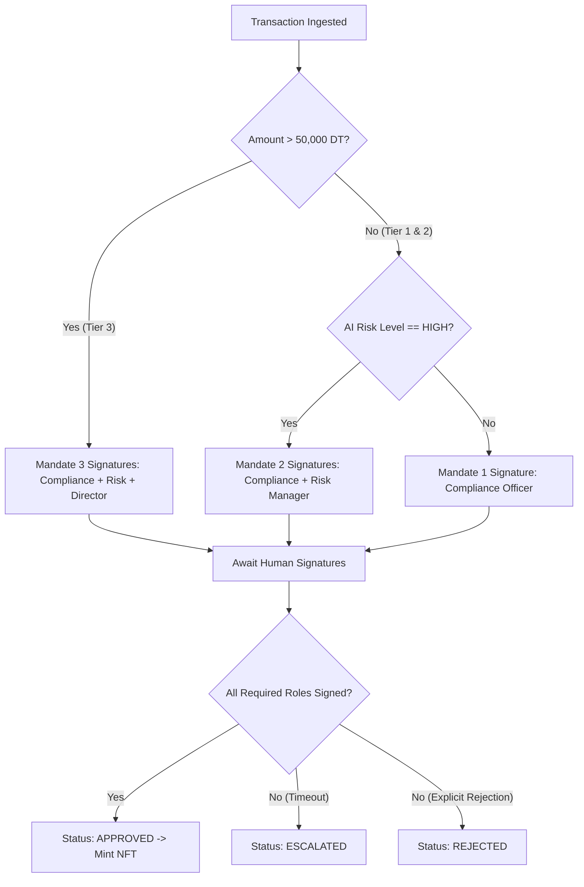

# TrustAudit — Quorum Policy & Governance Specification

## 1. Resolution of Specification Inconsistencies

Earlier draft documents and cahier des charges iterations exhibited ambiguous requirements regarding signature counts for transactions exceeding 50,000 DT (2 signatures in certain text sections vs. 3 signatures in demonstration flows). 

To ensure absolute consistency across smart contracts, backend validation, tests, UI, and academic presentation, the following **authoritative policy is frozen**:

---

## 2. Formal Quorum Rules

### 2.1 Transaction Value Tiers

| Tier Name | Transaction Amount (DT / EUR) | Base Quorum Required | Specific Mandatory Roles |
| :--- | :--- | :---: | :--- |
| **Tier 1 (Standard)** | `< 5,000 DT` | **1** | 1 × Compliance Officer (`COMPLIANCE_ROLE`) |
| **Tier 2 (Elevated)** | `5,000 DT` to `50,000 DT` inclusive | **1** | 1 × Compliance Officer (`COMPLIANCE_ROLE`) |
| **Tier 3 (High-Value)**| `> 50,000 DT` | **3** | • 1 × Compliance Officer (`COMPLIANCE_ROLE`) • 1 × Risk Manager (`RISK_MANAGER_ROLE`) • 1 × Director (`DIRECTOR_ROLE`) |

---

### 2.2 AI High-Risk Overlay Rule

In accordance with EU AI Act Article 14 (Mandatory Human-in-the-Loop for high-risk applications):
- If the AI Risk Engine assigns a **HIGH risk level** (`risk_score >= 70`):
  - An additional approval from a **Risk Manager (`RISK_MANAGER_ROLE`)** is strictly mandated, even if the transaction amount belongs to Tier 1 or Tier 2.
  - Specifically:
    - Tier 1 / Tier 2 with HIGH AI Risk requires **2 approvals**: `Compliance Officer` + `Risk Manager`.
    - Tier 3 with HIGH AI Risk retains the **3 approvals** rule: `Compliance` + `Risk Manager` + `Director`.
- **Advisory Primacy**: A LOW AI risk score can **never** bypass human approval or reduce the quorum below 1 human.
- **Human Disagreement (Override)**: Approvers may validate a high-risk case or reject a low-risk case. The smart contract captures whether the decision is an `isOverride` along with the obligatory `commentHash`.

---

## 3. Trusted Tier Assertion vs. Privacy Boundary

### 3.1 The Architectural Trade-Off
To respect banking secrecy and GDPR, the exact financial amount (e.g., `60,000.00 DT`) is stored **exclusively in the off-chain private database** and sealed inside `saltedInputHash`. It is not stored in plaintext on the blockchain.

However, the smart contract must enforce the correct quorum logic (1 vs 3 signatures).

### 3.2 Prototype Implementation: Trusted Tier Assertion
In this implementation:
1. The backend policy engine derives the `valueTier` (or `requiredApprovals`) deterministically from the validated transaction amount.
2. The Operator's transaction submits `valueTier` alongside `saltedInputHash` to `registerCase()`.
3. The contract verifies that `valueTier` is within valid enum bounds and configures `requiredApprovals`.
4. **Academic Transparency Notice**: The system explicitly documents that `valueTier` is an off-chain trusted assertion in this prototype. Hashing the amount does not mathematically prove that the correct tier was selected.

### 3.3 Future Evolution: Zero-Knowledge Range Proofs (ZK-SNARKs)
In a production deployment, a Zero-Knowledge proof (e.g., Groth16 via Circom or Noir) would be submitted to the contract. The ZK-SNARK would cryptographically prove:
$$\text{amount} > 50,000 \quad \text{and} \quad \text{saltedInputHash} = \text{SHA256}(\text{"TrustAudit:v1"} \parallel \text{data} \parallel \text{salt})$$
without revealing the plaintext amount to the validator nodes or public block explorer.

---

## 4. Quorum Verification Matrix

