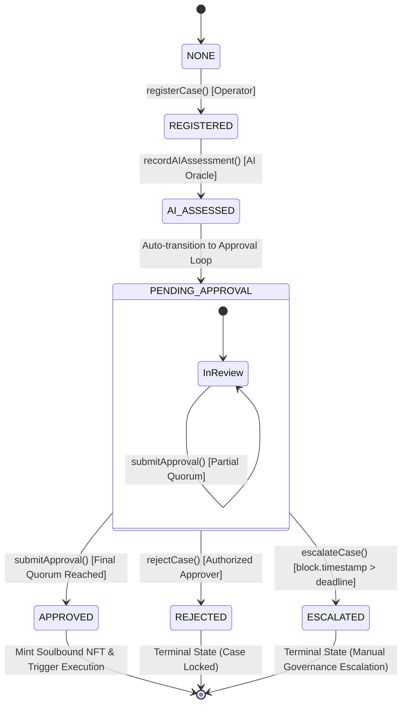

# TrustAudit — Smart Contract State Machine

## 1. Lifecycle State Machine Diagram

---

## 2. State Definitions

| State Name | Enum Value | Semantic Meaning | Mutability |
| :--- | :---: | :--- | :--- |
| `NONE` | 0 | Case does not exist in contract storage. | Uninitialized |
| `REGISTERED` | 1 | Case created by Operator with commitment hash; awaiting AI risk scoring. | Transitional |
| `AI_ASSESSED` | 2 | AI Oracle has anchored risk score, category, and explanation hash. | Transitional |
| `PENDING_APPROVAL`| 3 | Active human review window; awaiting required signatures according to quorum policy. | Active Loop |
| `APPROVED` | 4 | All mandatory human approvals received; Soulbound Certificate minted. Terminal state. | **Immutable Final** |
| `REJECTED` | 5 | An authorized reviewer formally rejected the case with written motivation. Terminal state. | **Immutable Final** |
| `ESCALATED` | 6 | Case deadline exceeded without reaching required quorum or rejection. Terminal state. | **Immutable Final** |

---

## 3. State Transition Matrix & Guard Conditions

| From State | To State | Trigger Function | Authorized Caller | Mandatory Guard Conditions | Failure Custom Error |
| :--- | :--- | :--- | :--- | :--- | :--- |
| `NONE` | `REGISTERED` | `registerCase()` | `OPERATOR_ROLE` | • `cases[caseId].status == CaseStatus.NONE` • `saltedInputHash != bytes32(0)` • `deadline > block.timestamp` | `CaseAlreadyExists()` `InvalidHash()` `InvalidDeadline()` |
| `REGISTERED` | `PENDING_APPROVAL` | `recordAIAssessment()` | `AI_ORACLE_ROLE` | • `cases[caseId].status == CaseStatus.REGISTERED` • `score <= 100` • `explanationHash != bytes32(0)` | `InvalidCaseStatus()` `ScoreOutOfBounds()` `InvalidHash()` |
| `PENDING_APPROVAL` | `PENDING_APPROVAL` | `submitApproval()` | Compliance / Risk / Director | • `status == CaseStatus.PENDING_APPROVAL` • `block.timestamp <= deadline` • `msg.sender != case.operator` • `!hasApproved[caseId][msg.sender]` • `approvalCount + 1 < requiredApprovals` | `InvalidCaseStatus()` `DeadlineExpired()` `OperatorCannotApprove()` `AlreadyApproved()` |
| `PENDING_APPROVAL` | `APPROVED` | `submitApproval()` | Compliance / Risk / Director | • All prior guards satisfied • `approvalCount + 1 >= requiredApprovals` • Specific role requirements satisfied (e.g., Risk Manager if HIGH risk) | (Same as above) + triggers `mintCertificate()` |
| `PENDING_APPROVAL` | `REJECTED` | `rejectCase()` | Compliance / Risk / Director | • `status == CaseStatus.PENDING_APPROVAL` • `block.timestamp <= deadline` • `commentHash != bytes32(0)` | `InvalidCaseStatus()` `DeadlineExpired()` `EmptyJustification()` |
| `PENDING_APPROVAL` | `ESCALATED` | `escalateCase()` | Permissionless (Anyone / Keeper) | • `status == CaseStatus.PENDING_APPROVAL` • `block.timestamp > deadline` | `InvalidCaseStatus()` `DeadlineNotExceeded()` |

---

## 4. Invariant Rules Governing Transitions

1. **Terminal State Finality**: Once a case enters `APPROVED`, `REJECTED`, or `ESCALATED`, no further state modifications, signatures, or status changes are permitted under any circumstances.
2. **AI Cannot Finalize**: A case can **never** transition directly from `REGISTERED` to `APPROVED` or `REJECTED`. It must pass through `PENDING_APPROVAL` and receive human signatures.
3. **Strict Separation of Duties**: The address that registered the case (`operator`) is permanently barred from transitioning it to `APPROVED` or `REJECTED`.
4. **Quorum Atomicity**: The transition to `APPROVED` and the invocation of `TrustAuditCertificate.mintCertificate` occur atomically within the same transaction. If minting fails, the approval transaction reverts.
