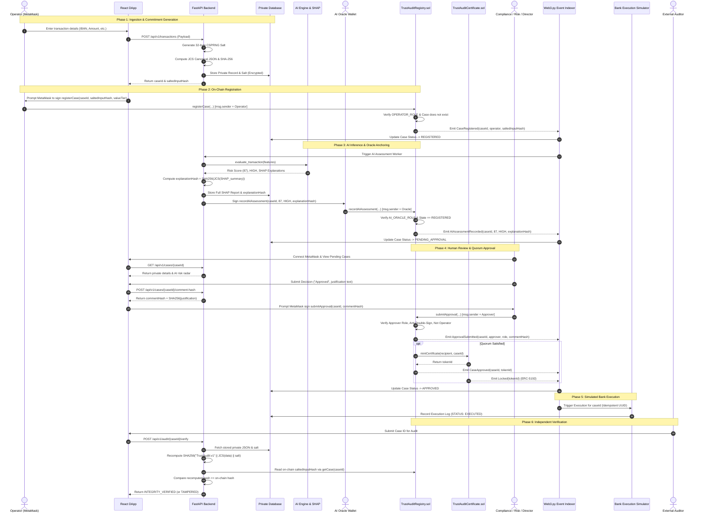

# TrustAudit — System Design & Sequence Flows

## 1. End-to-End Workflow Sequence

The TrustAudit lifecycle orchestrates off-chain data creation, cryptographic commitment generation, on-chain state progression, multi-role human approval, Soulbound NFT minting, and asynchronous bank execution.

---

## 2. Failure & Edge Case Handling

| Scenario | System Behavior | Recovery Action |
| :--- | :--- | :--- |
| **MetaMask Rejection / User Cancel** | Transaction is aborted in browser. Local contract state is unchanged. | DApp catches RPC error 4001; displays notification; case remains in current state. |
| **Network Mismatch (Non-Ganache)** | DApp detects `chainId != 1337` (or configured Ganache ID). | DApp disables transaction buttons and prompts `wallet_switchEthereumChain`. |
| **AI Engine Unavailable / Crashes** | Ingestion completes; case remains in `REGISTERED`. | Backend flags `AI_UNAVAILABLE`. Case **never** auto-approves or defaults to LOW risk. Manual fallback queue triggered. |
| **Approval Deadline Expired** | Case in `PENDING_APPROVAL` exceeds `deadline` timestamp. | Any caller or backend cron calls `escalateCase(caseId)`. Contract transitions status to `ESCALATED`. Approvals locked. |
| **Double Approval Attempt** | Same approver attempts to sign twice on a single case. | Contract checks `hasApproved[caseId][msg.sender]` and reverts with custom error `AlreadyApproved()`. |
| **Operator Attempts Approval** | Case creator attempts to call `submitApproval`. | Contract checks `msg.sender != auditCase.operator` and reverts with `OperatorCannotApprove()`. |
| **Duplicate Bank Execution Attempt** | Indexer receives repeated `CaseApproved` event or restarts. | Execution service checks unique database constraint on `case_id` in `execution_records`. Operation is idempotent. |

---

## 3. Bank Execution Simulator Architecture

The execution of financial transfers must never be confused with the smart contract approval:
1. The EVM smart contract is the **authoritative governance gate**, granting cryptographic clearance.
2. The **Bank Execution Simulator** represents the institutional core banking switch (e.g., SWIFT / SEPA / ACH adapter).
3. **Idempotency Guarantee**:
   $$\text{IdempotencyKey} = \text{SHA256}(\text{"EXECUTE:"} \parallel \text{caseId} \parallel \text{chainId})$$
   When the indexer catches `CaseApproved`, it passes this key to `ExecutionService`. If an execution entry with that key already exists, the event is acknowledged without repeating the transfer.
